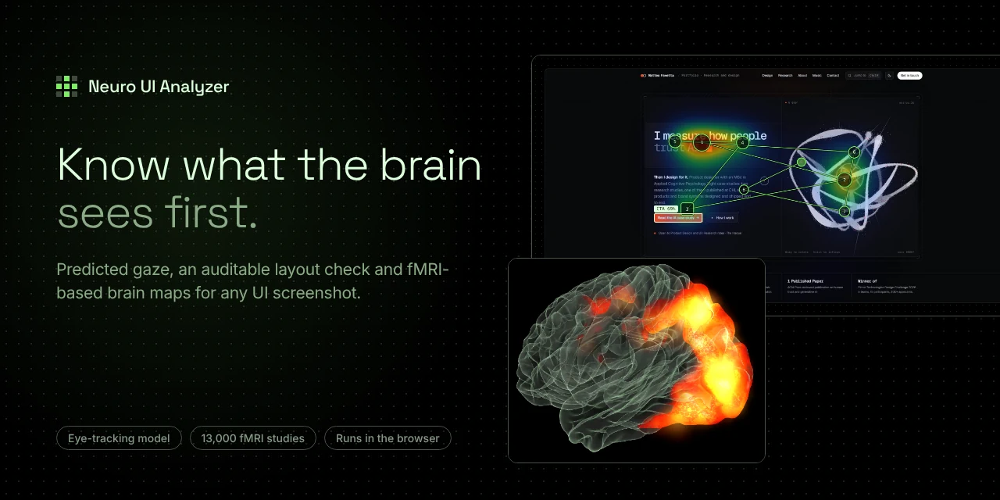
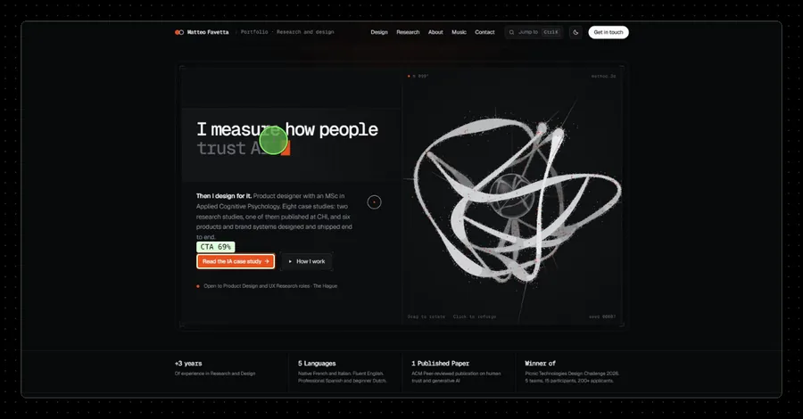
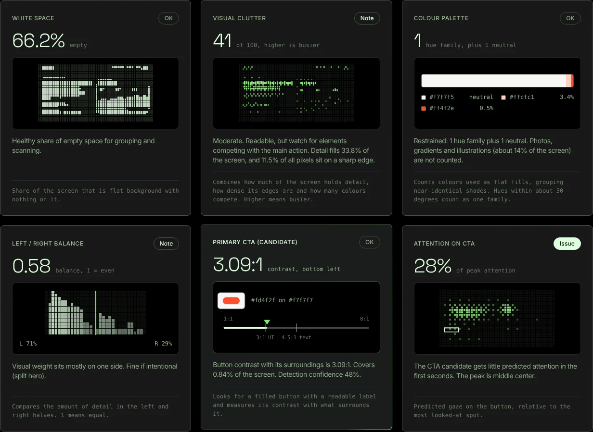

<p align="center">
  
</p>

<h1 align="center">Neuro UI Analyzer</h1>

<p align="center">
  Predict where attention lands on an interface, check the layout against perception research,<br>
  and see which brain systems a design is likely to engage. Before you spend a user test on it.
</p>

<p align="center">
  <a href="https://github.com/mavett24/neuro-ui-analyzer/actions/workflows/ci.yml"></a>
  <a href="LICENSE"></a>
  
  
  
  
</p>

<p align="center">
  <a href="https://neuro-ui-analyzer.vercel.app"><b>Live demo</b></a> ·
  <a href="docs/METHOD.md">Method</a> ·
  <a href="docs/ARCHITECTURE.md">Architecture</a> ·
  <a href="#getting-started">Getting started</a> ·
  <a href="THIRD_PARTY_NOTICES.md">Data licenses</a>
</p>

<p align="center">
  
  <br><sub>Predicted first 3 seconds of viewing, from a gaze model trained on eye-tracking data.</sub>
</p>

## Why

User testing tells you how real people look at a design, but it's slow and expensive, so most layout decisions are made without it. This tool gives a research-grounded prediction in seconds: where the eyes go first, whether the main action gets seen, and what the layout asks of the viewer.

Every number is an estimate, it says so, and it shows how it was computed. The same image always gives the same reading, so two versions of a design can be compared fairly.

## Features

| | |
| --- | --- |
| **Predicted attention**<br>A saliency model trained on human eye-tracking predicts a gaze heatmap. A scanpath model turns it into an ordered sequence of fixations over the first 3 seconds, and reports whether and when the primary CTA gets seen. |  |
| **Layout diagnostics**<br>Six measures computed straight from the pixels, with no AI: white space, visual clutter, colour palette, left/right balance, CTA contrast and attention on the CTA. Each card shows the data behind its number. |  |
| **Brain regions**<br>Ten meta-analytic fMRI maps from about 13,000 studies, weighted by what was measured in the design. Shown on a rotatable 3D cortex and as MRI slices with region names. |  |
| **History**<br>Every analysis is saved in the browser. Reopening one restores the exact report instantly, with nothing recomputed and nothing uploaded. |  |

An optional **deep research analysis** sends a downscaled copy to a vision model. It detects content (text, faces, imagery, prices, actions) to add six more brain functions, then writes a review that names the design principle behind each issue.

## How it works

<p align="center">
  
</p>

1. **Decode.** The screenshot is decoded and downscaled in halving steps, because a single large resize blurs thin text and shifts predicted attention off headlines.
2. **Layout heuristics.** 8 px blocks are classified as empty, detail or imagery. The palette is clustered in OKLab, and filled buttons are scored and returned only above a confidence threshold.
3. **Gaze model.** [UNISAL](https://github.com/rdroste/unisal) runs through ONNX Runtime Web. The fixation order follows winner-take-all with inhibition of return (Itti, Koch & Niebur, 1998).
4. **Brain weighting.** Measured features become weights on [NeuroQuery](https://neuroquery.org) maps, blended and drawn with Niivue and three.js.

The full method, with every formula and threshold, is in [docs/METHOD.md](docs/METHOD.md). Design decisions and the data flow are in [docs/ARCHITECTURE.md](docs/ARCHITECTURE.md).

## Tech stack

| Area | Choice |
| --- | --- |
| Framework | Next.js 16 (App Router), React 19 |
| In-browser ML | ONNX Runtime Web (WASM) running UNISAL |
| 3D and imaging | three.js for the cortical surface, Niivue for MRI slices |
| Storage | IndexedDB, keyed by a SHA-256 of the image |
| AI review | Mistral API through server routes, streamed |
| Quality | Vitest, ESLint (`next/core-web-vitals`), Prettier, GitHub Actions |

## Getting started

Requires Node.js 20 or newer.

```bash
git clone https://github.com/mavett24/neuro-ui-analyzer.git
cd neuro-ui-analyzer
npm install
npm run dev
```

Open http://localhost:3000. The landing page is at `/` and the analyzer at `/app`.

Everything except the deep research analysis works without any setup. To enable it, copy `.env.example` to `.env.local` and add a free key from [Mistral](https://console.mistral.ai/api-keys):

```bash
MISTRAL_API_KEY=your-key
```

| Script | What it does |
| --- | --- |
| `npm run dev` | Start the dev server |
| `npm run build` | Production build |
| `npm test` | Run the unit tests |
| `npm run lint` | ESLint |
| `npm run format` | Prettier |
| `npm run check` | Lint, format check and tests, as in CI |

### Deploy

Import the repository in Vercel and add `MISTRAL_API_KEY` under Project Settings, Environment Variables. No other configuration is needed.

## Testing

The analysis core is pure functions over pixel arrays, so it's tested in Node with synthetic screenshots drawn straight into RGBA buffers. No browser or canvas is needed.

- **Determinism:** the same pixels always produce identical metrics and findings.
- **Layout:** a blank screen, clutter ordering, metric ranges, and a regression test for grey gradients inflating the palette.
- **CTA detection:** finds a labelled filled button at the right position, and returns nothing for blank screens or unlabelled blocks.
- **Scanpath:** the first fixation lands on the peak, targets are visited in order of salience, timing stays within the 3 second window, and the CTA hit is reported.
- **Brain weighting:** every function stays in range with a written reason, and content-based functions stay pending until content is detected.

CI runs lint, the format check, tests and a production build on every push and pull request.

## Privacy

The gaze model, layout analysis, brain maps and history all run in the browser. Screenshots never leave the device unless the user starts a deep research analysis, which sends a downscaled JPEG to the Mistral API. Mistral AI is based in France and hosts API data in the EU by default, and the project's account is opted out of model training.

## Assumptions and limits

This is a prediction tool, not a measurement of real users.

- **The gaze model was trained on photos, not interfaces.** It's a strong prior for where people look, not a recording. It also can't see motion, so animated elements are likely underrated.
- **Free viewing only.** The prediction covers the first seconds without a specific task in mind.
- **The brain view is an estimate, not a scan.** The maps describe where research places each function across a population. How strongly a design engages each one is this tool's model, and the formula is shown on every card.
- **Only filled buttons count as CTA candidates.** Ghost buttons and text links are skipped.
- **The deep analysis can misread a screen.** The measured numbers stay the evidence.

## License

The source code is released under the [MIT license](LICENSE).

The model weights and brain data in `public/` keep their original licenses (Apache 2.0, BSD and the MNI notice), listed in [THIRD_PARTY_NOTICES.md](THIRD_PARTY_NOTICES.md). The two AAL atlas files are under the GNU GPL and are not covered by the MIT license.

## Credits

Built by [Matteo Favetta](https://matteofavetta.com), product designer with an MSc in Applied Cognitive Psychology.

Research behind the tool: Droste, Jiao & Noble (2020) for UNISAL; Dockès et al. (2020) for NeuroQuery; Itti, Koch & Niebur (1998) for the scanpath model; Tzourio-Mazoyer et al. (2002) for the AAL atlas; and the McConnell Brain Imaging Centre for the ICBM152 template.
