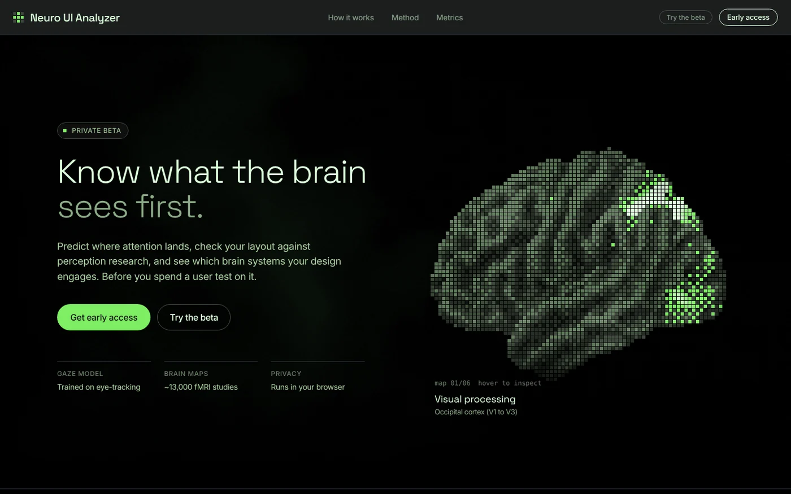
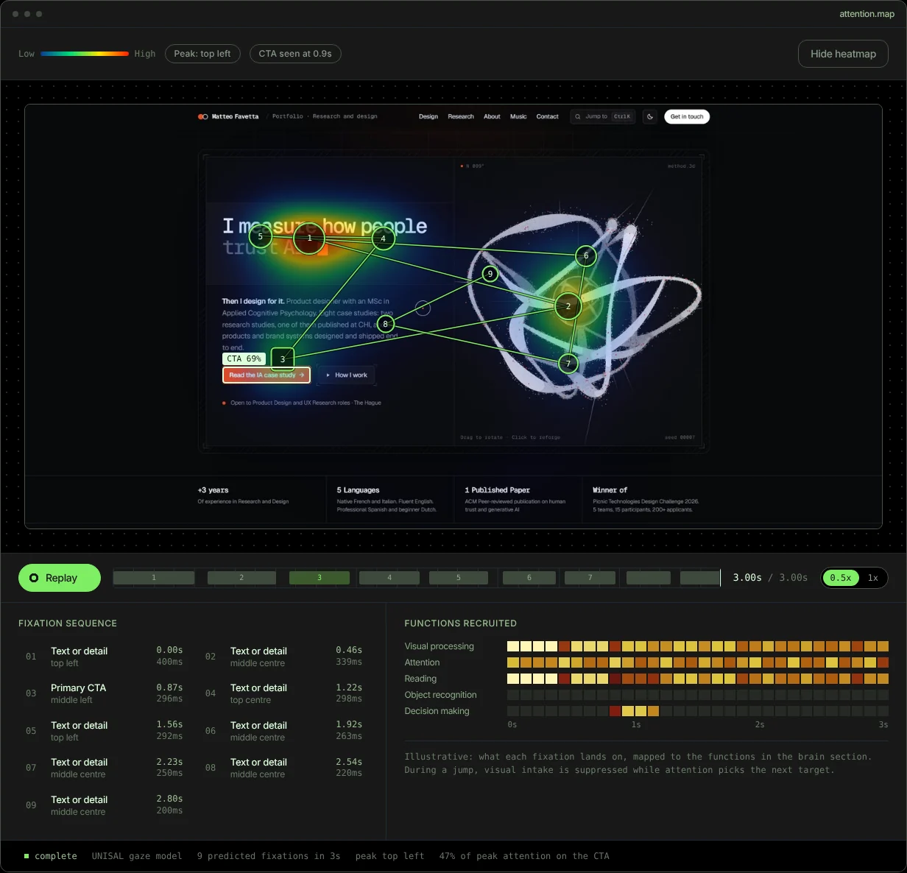
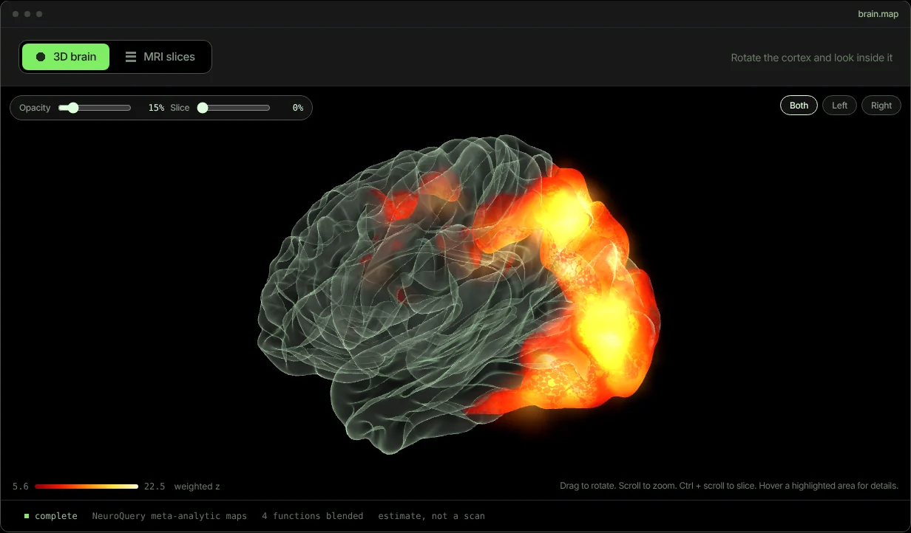
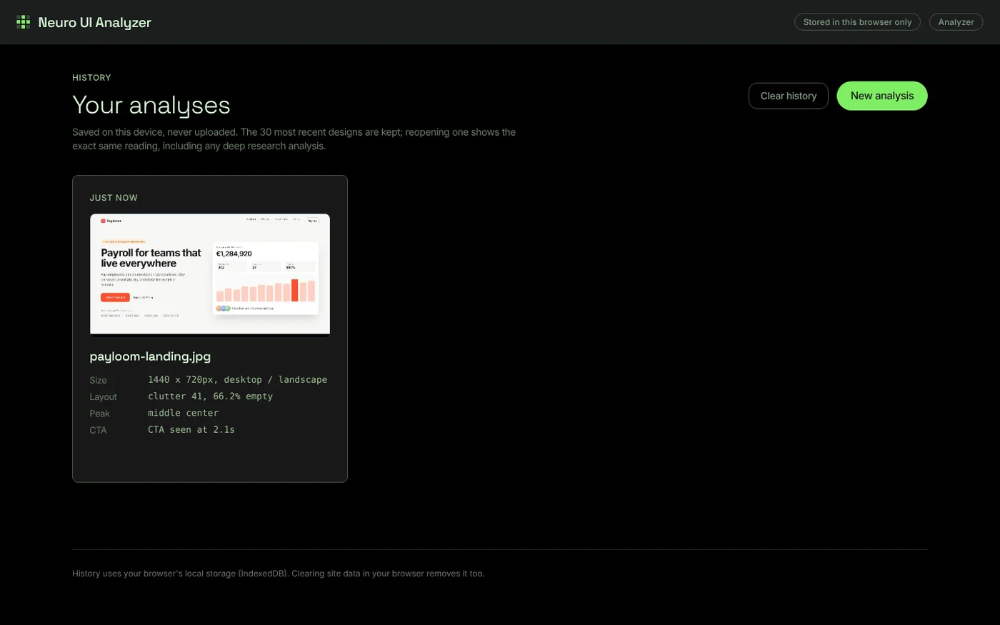

# Neuro UI Analyzer

Upload a screenshot of an interface and get a prediction of how people will look at it: where attention lands in the first three seconds, how the layout measures up against perception research, and which brain systems the design is likely to engage.

Every number is labelled as an estimate and shows how it was computed. Same image in, same reading out.



## What it does

**1. Predicted attention**

A gaze model trained on human eye-tracking data predicts where people look during free viewing. The app turns that map into a predicted sequence of fixations over the first three seconds and checks whether, and when, the primary CTA gets seen.



**2. Layout diagnostics**

Six measures computed straight from the pixels, with no AI involved: white space, visual clutter, colour palette, left/right balance, CTA contrast and attention on the CTA. Each card shows the data behind its number and how it was measured.


**3. Brain regions**

Real meta-analytic fMRI maps, one per cognitive function (visual processing, attention, working memory load, colour, reading, faces, objects, scenes, reward, decision making), weighted by what was measured in the design. Shown on a 3D cortical surface and as MRI slices with region names.



**4. Deep research analysis (optional)**

On request, a vision model reads the content of the screen (text, faces, imagery, prices, actions) to add six content-based functions to the brain map, then writes a review that names the design principle behind each issue.

**5. History**

Every analysis is saved in the browser, so you can reopen a past design and get the exact same report, including any deep analysis, without running anything again.



## How it works

| Part | Method | Runs |
| --- | --- | --- |
| Attention | UNISAL saliency model (ONNX), then winner-take-all with inhibition of return for the fixation order | In the browser |
| Layout | Block-based pixel analysis, colours grouped in OKLab, CTA contrast checked against WCAG 2.2 non-text contrast | In the browser |
| Brain | NeuroQuery maps weighted by the measured features, drawn on the ICBM152 surface with AAL region labels | In the browser |
| Deep analysis | Gemini API (free tier) for content detection and the written review | Server route, opt-in |
| History | IndexedDB, keyed by a SHA-256 hash of the image | In the browser |

Images never leave the device unless you ask for the deep research analysis.

## Assumptions and limits

This is a prediction tool, not a measurement of real users.

- **The gaze model was trained on photos, not interfaces.** It is a strong prior for where people look, not a recording. It also can't see motion, so animated elements are likely underrated.
- **Free viewing only.** The prediction covers the first seconds without a specific task in mind. Once a user is looking for something, goals take over.
- **The brain view is an estimate, not a scan.** The maps come from published studies and describe where research places a function across a population. How strongly a design engages each one is this tool's model, and the formula is shown on every card.
- **Only filled buttons count as CTA candidates.** Ghost buttons and text links are skipped.
- **The deep analysis can misread a screen.** The measured numbers stay the evidence.

## Run locally

Requires Node.js 20 or newer.

```bash
npm install
cp .env.example .env.local   # then paste a free Gemini key from https://aistudio.google.com/apikey
npm run dev
```

Open http://localhost:3000. Everything except the deep research analysis works without a key.

## Deploy

Import the repository in Vercel and add `GEMINI_API_KEY` under Project Settings, Environment Variables.

## Project structure

```
app/
  page.js              landing page
  app/page.js          the analyzer
  history/page.js      saved analyses
  brain/page.js        standalone brain viewer demo
  api/features/        content detection (Gemini)
  api/review/          written review (Gemini, streamed)
components/            analyzer UI, brain viewer, landing page visuals
lib/
  heuristics.js        layout metrics and the analysis pipeline
  saliency.js          UNISAL inference
  scanpath.js          predicted fixation sequence
  cta.js               primary button detection
  brain.js             feature to brain-map weighting
  regions.js           AAL region names and descriptions
  history.js           IndexedDB history
public/
  models/unisal.onnx   gaze model
  brain/               precomputed maps, surface mesh and atlas
```

## Status

Working beta. The waitlist form on the landing page is a front end only and doesn't store emails yet.

## Credits

- UNISAL: Droste, Jiao & Noble (2020), *Unified Image and Video Saliency Modeling*, ECCV. Apache 2.0.
- NeuroQuery: Dockès et al. (2020), *NeuroQuery, comprehensive meta-analysis of human brain mapping*, eLife.
- ICBM152 template: McConnell Brain Imaging Centre, Montreal Neurological Institute.
- AAL atlas: Tzourio-Mazoyer et al. (2002), NeuroImage.
- Scanpath method: Itti, Koch & Niebur (1998), IEEE PAMI.
- ONNX Runtime Web, Niivue and three.js for inference and rendering.

The model weights and brain data in `public/` are redistributed under their original terms. Check those before any commercial use.

## License

Copyright (c) 2026 Matteo Favetta. All rights reserved. The source is public to read; ask before reusing it.

Built by [Matteo Favetta](https://matteofavetta.com), product designer with an MSc in Applied Cognitive Psychology.
