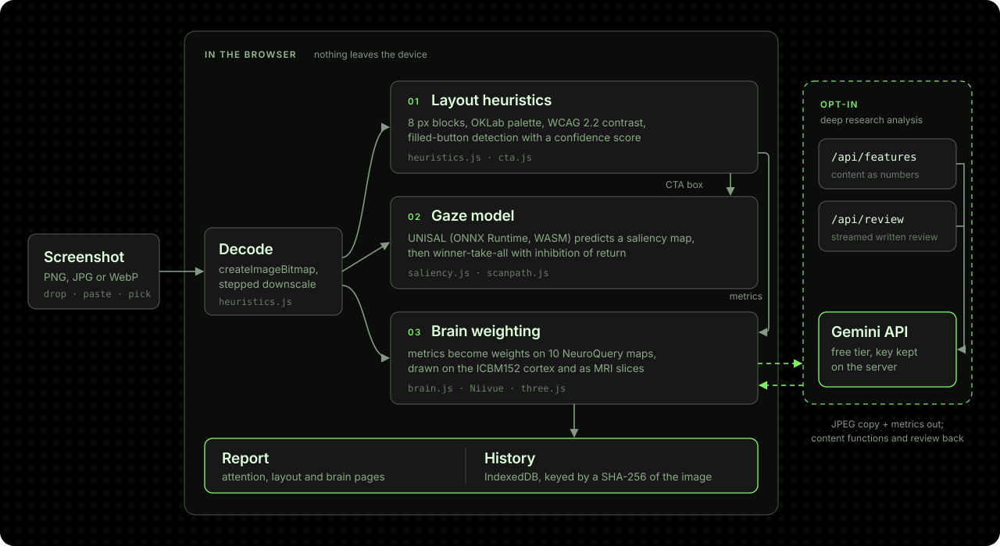
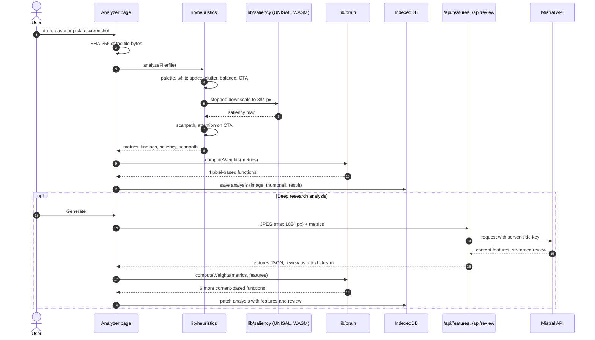

# Architecture

Neuro UI Analyzer is a Next.js app where almost everything runs in the browser. The server holds one secret, the Mistral API key, and is only involved when the user asks for the deep research analysis.

## Request flow

## Module map

| Path | Responsibility | Runs |
| --- | --- | --- |
| `app/page.js` | Landing page | Server-rendered, static |
| `app/app/page.js` | Analyzer: upload, report, section nav, deep analysis | Client |
| `app/history/page.js` | Saved analyses | Client |
| `app/api/features/route.js` | Content detection through Mistral, returned as numbers | Server |
| `app/api/review/route.js` | Written review through Mistral, streamed as plain text | Server |
| `lib/heuristics.js` | Analysis entry point and the pixel metrics | Browser, pure core |
| `lib/cta.js` | Filled-button detection with a confidence score | Pure |
| `lib/saliency.js` | UNISAL inference, contrast fallback, heatmap drawing | Browser |
| `lib/scanpath.js` | Predicted fixation sequence | Pure |
| `lib/brain.js` | Feature-to-function weights, map blending, data loading | Pure core, fetches data |
| `lib/history.js` | IndexedDB store for saved analyses | Browser |
| `lib/hooks.js` | SSR-safe reads of browser state | Client |
| `components/` | Brain viewer (Niivue slices, three.js surface), gaze player, cards | Client |

The pure functions take plain arrays and return plain objects, so they're unit-tested in Node with synthetic screenshots (`test/`).

## Data assets

| File | Size | Contents |
| --- | --- | --- |
| `public/models/unisal.onnx` | 12.8 MB | UNISAL image saliency model |
| `public/brain/terms.bin` | 1.1 MB | 10 NeuroQuery z-maps, 8-bit, with scale in `terms.json` |
| `public/brain/surface.bin` | 0.8 MB | The same maps sampled at each cortical vertex, both hemispheres |
| `public/brain/mesh.bin` | 0.8 MB | ICBM152 cortex: int16 positions, uint16 faces, uint8 convexity |
| `public/brain/labels.bin` | 80 KB | AAL region index per vertex |
| `public/brain/mni152.nii.gz`, `aal.nii.gz` | 0.4 MB | Anatomy and atlas volumes for the MRI slices |
| `public/ort/` | 15 MB | ONNX Runtime WASM, copied from `node_modules` on install, not committed |

All assets are fetched lazily, only when a page needs them, and cached by the browser afterwards.

## Design decisions

**Inference in the browser, not on a server.** The gaze model is small enough to run on the client, so screenshots never leave the device and there's no GPU bill. The cost is a one-time download of about 28 MB (model plus runtime) on the first analysis. ONNX Runtime runs single-threaded, which avoids the cross-origin isolation headers that threaded WASM needs.

**Determinism is a feature.** Users compare versions of a design, so the same image must always give the same reading. All the pixel code is deterministic (no randomness, fixed thresholds), the scanpath model is deterministic, and the AI output is cached per image hash. A test asserts it.

**Precomputed brain data.** The NeuroQuery model isn't run live. Ten term maps were exported once and quantized to 8 bits, which keeps the brain data around 3 MB. Blending them by weight is a weighted sum, cheap enough to redo on every change.

**One server boundary.** Both AI calls go through Next.js route handlers, so the API key is never sent to the browser and the provider can be swapped by editing two files. The review route tries a list of models, skips any that send nothing within 12 seconds, and streams the answer so text appears as it's written.

**IndexedDB for history.** An analysis includes a saliency map (a `Float32Array`) and the original image, which rules out cookies (4 KB) and makes `localStorage` (strings only, about 5 MB) a poor fit. IndexedDB stores both natively through structured cloning. Records are keyed by the image hash, so re-uploading a design updates its entry instead of duplicating it.

**Hydration-safe browser reads.** Values such as reduced-motion preference, platform and URL parameters are read through `useSyncExternalStore` (`lib/hooks.js`). The server renders a stable default and the client switches to the real value without a mismatch or an extra effect.

## Limits

- The first analysis downloads the model and runtime, so it's slow on a weak connection.
- Very tall screenshots are capped at 1024 px high for the gaze model.
- History lives in one browser. Clearing site data removes it, and nothing syncs across devices.
- The Mistral free tier allows about one request per second, so analyses from many visitors at once can queue or fail.
